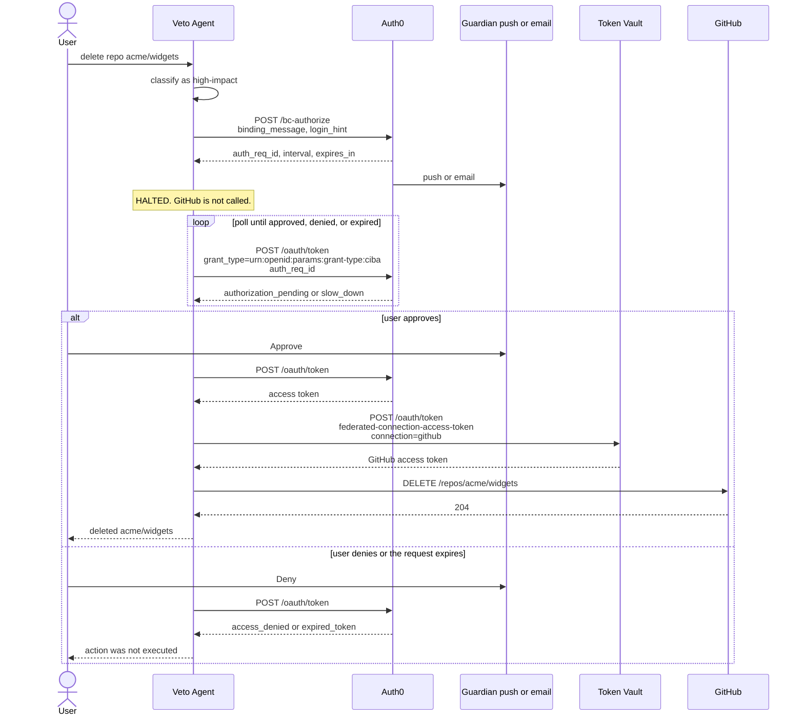

# The Veto Agent

An AI agent that does GitHub work for a signed-in user. Reading data runs immediately. Deleting a repository, closing every open issue, or archiving a repository pauses the agent and waits for the user to approve that one action on another device.

Two Auth0 for AI Agents features make that split:

- **Token Vault** stores the user's GitHub access token on the connected GitHub account. The agent exchanges the user's Auth0 refresh token for that GitHub token (`urn:auth0:params:oauth:grant-type:token-exchange:federated-connection-access-token`) and calls the GitHub API with it.
- **Client-Initiated Backchannel Authentication (CIBA)** asks the user to approve a high-impact action out of band. Auth0 delivers the request as a Guardian push (or an email, when the request lives longer than five minutes). The agent polls `POST /oauth/token` with `grant_type=urn:openid:params:grant-type:ciba` and the `auth_req_id` until the user approves, denies, or the request expires. GitHub is not called while the poll is pending.

Tenant: `dev-wvxvhbnjrgvgn26x.us.auth0.com`.

The CIBA wait uses the same polling loop as `@auth0/ai`'s `AsyncAuthorizerBase.getCredentialsPolling`, including its interrupt types (`AccessDeniedInterrupt`, `AuthorizationRequestExpiredInterrupt`, `AuthorizationPendingInterrupt`, `AuthorizationPollingInterrupt`). The live client is `AuthenticationClient.backchannel` from the `auth0` SDK, which is what `@auth0/ai` calls. The Token Vault exchange uses `SUBJECT_TOKEN_TYPES` from `@auth0/ai` and the same grant body as `TokenVaultAuthorizerBase`. This sample is a CLI, so it drives those calls directly and prints every poll. That keeps the pause, the approval, and the denial runnable under `MOCK_CIBA=1` without an LLM key or Auth0 credentials.

`@auth0/ai` 6 still imports `AuthenticationClient` from `auth0` v4. This project pins `auth0` to v4 for that reason.

## Actions

| Command | Impact | What runs |
| --- | --- | --- |
| `list repos` | Read | Token Vault, then `GET /user/repos` |
| `list open issues <owner/repo>` | Read | Token Vault, then `GET /repos/{owner}/{repo}/issues?state=open` |
| `delete repo <owner/repo>` | High impact | CIBA, then Token Vault, then `DELETE /repos/{owner}/{repo}` |
| `close all issues <owner/repo>` | High impact | CIBA, then Token Vault, then close each open issue |
| `archive repo <owner/repo>` | High impact | CIBA, then Token Vault, then `PATCH` `{"archived": true}` |

Phrases such as "please delete the repository acme/widgets" and "list open issues in acme/widgets" map to those tools. The binding message Auth0 shows the user is a short string such as `Veto delete_repo acme:widgets` (64 characters, Auth0's binding-message alphabet).

Exit codes: `0` completed, `2` user denied, `3` request expired, `1` error.

## Sequence



A read such as `list repos` skips `/bc-authorize` and goes straight to Token Vault, then GitHub.

`requested_expiry` picks the channel, matching Auth0's CIBA rules:

- `1`–`300` seconds: Auth0 Guardian push. The default is `120`.
- `301`–`259200` seconds: email to the user's verified address. Set `CIBA_REQUESTED_EXPIRY=600` to use email.

On `slow_down`, the agent waits for the `Retry-After` value, or adds five seconds to the interval, and polls again.

## Quick start

No Auth0 application and no GitHub token are required. `.env.example` already sets both mock flags.

```bash
cp .env.example .env
npm install
npm test
npm run veto -- list repos
npm run demo:approval
```

`npm run demo:approval` rewrites `examples/sensitive-command-approval.log`. The transcript below is that file: a delete sits on `authorization_pending`, another command approves it, and only then does Token Vault and `DELETE` run. A later archive is denied and the repository stays unarchived.

Try the same pause yourself in two terminals (both from this directory, with the `.env` mocks on):

```bash
# terminal A — this process blocks
npm run veto -- delete repo acme/widgets

# terminal B — after A prints HALTED and authorization_pending
npm run veto -- pending
npm run veto -- approve ciba_<id from the log>
```

`veto deny <auth_req_id>` rejects the waiting command. Mock GitHub state and the mock Auth0 port live in `CIBA_STATE_DIR` (default `.veto-runtime`), so both terminals must share that directory.

## Example run

`MOCK_CIBA=1` and `MOCK_GITHUB=1`. The placeholders in `.env.example` are the only credentials this run used.

```text
# The Veto Agent — example run
# MOCK_CIBA=1 MOCK_GITHUB=1 (no Auth0 or GitHub credentials)
# A delete halts on authorization_pending until another terminal approves it.
# Generated by npm run demo:approval

===== 1. list repos (read — no approval) =====
$ veto list repos
2026-11-09T07:30:46.007Z  agent    understood command as list_repos  input="list repos"
2026-11-09T07:30:46.008Z  policy   read-only action runs without asynchronous approval  action=list_repos  approval=skipped
2026-11-09T07:30:46.008Z  vault    POST /oauth/token  grant_type=urn:auth0:params:oauth:grant-type:token-exchange:federated-connection-access-token  subject_token_type=urn:ietf:params:oauth:token-type:refresh_token  requested_token_type=http://auth0.com/oauth/token-type/federated-connection-access-token  connection=github  mock=true
2026-11-09T07:30:46.008Z  vault    stored GitHub access token from Token Vault  connection=github  expires_in=3600  token=gho_mock…  mock=true
2026-11-09T07:30:46.009Z  github   GET /user/repos  status=200  mock=true
2026-11-09T07:30:46.014Z  agent    completed  action=list_repos

acme/notes  private=true  archived=false  open_issues=1  Internal notes
acme/widgets  private=false  archived=false  open_issues=2  Demo widget service

===== 2. list open issues (read — no approval) =====
$ veto list open issues in acme/widgets
2026-11-09T07:30:46.279Z  agent    understood command as list_open_issues repository=acme/widgets  input="list open issues in acme/widgets"
2026-11-09T07:30:46.280Z  policy   read-only action runs without asynchronous approval  action=list_open_issues  approval=skipped
2026-11-09T07:30:46.280Z  vault    POST /oauth/token  grant_type=urn:auth0:params:oauth:grant-type:token-exchange:federated-connection-access-token  subject_token_type=urn:ietf:params:oauth:token-type:refresh_token  requested_token_type=http://auth0.com/oauth/token-type/federated-connection-access-token  connection=github  mock=true
2026-11-09T07:30:46.280Z  vault    stored GitHub access token from Token Vault  connection=github  expires_in=3600  token=gho_mock…  mock=true
2026-11-09T07:30:46.280Z  github   GET /repos/acme/widgets/issues  status=200  state=open  mock=true
2026-11-09T07:30:46.281Z  agent    completed  action=list_open_issues

#1  open  Fix login
#2  open  Update docs

===== 3. delete repo (high-impact — agent halts) =====
$ veto delete repo acme/widgets
2026-11-09T07:30:46.546Z  agent    understood command as delete_repo repository=acme/widgets  input="delete repo acme/widgets"
2026-11-09T07:30:46.546Z  policy   high-impact action requires out-of-band approval before GitHub is called  action=delete_repo  approval=required  channel=guardian-push
2026-11-09T07:30:46.551Z  ciba     POST /bc-authorize  binding_message="Veto delete_repo acme:widgets"  scope="openid github:mutate"  requested_expiry=30  channel=guardian-push
2026-11-09T07:30:46.565Z  ciba     authorization request issued  auth_req_id=ciba_738f836d448cd722  interval=0.3  expires_in=30
2026-11-09T07:30:46.565Z  ciba     HALTED waiting for out-of-band approval  auth_req_id=ciba_738f836d448cd722  binding_message="Veto delete_repo acme:widgets"  channel=guardian-push  github_called=false  action="delete_repo repository=acme/widgets"
2026-11-09T07:30:46.565Z  ciba     approve out of band in another terminal  command="npm run veto -- approve ciba_738f836d448cd722"
2026-11-09T07:30:46.568Z  ciba     POST /oauth/token  grant_type=urn:openid:params:grant-type:ciba  auth_req_id=ciba_738f836d448cd722  result=authorization_pending
2026-11-09T07:30:46.871Z  ciba     POST /oauth/token  grant_type=urn:openid:params:grant-type:ciba  auth_req_id=ciba_738f836d448cd722  result=authorization_pending

===== 4. out-of-band approval (other terminal) =====
$ veto approve ciba_738f836d448cd722
approved ciba_738f836d448cd722  Veto delete_repo acme:widgets

===== 5. agent resumes after approval =====
$ veto (same delete command)
2026-11-09T07:30:47.172Z  ciba     POST /oauth/token  grant_type=urn:openid:params:grant-type:ciba  auth_req_id=ciba_738f836d448cd722  result=approved  ciba_token=ciba_app…
2026-11-09T07:30:47.173Z  vault    POST /oauth/token  grant_type=urn:auth0:params:oauth:grant-type:token-exchange:federated-connection-access-token  subject_token_type=urn:ietf:params:oauth:token-type:refresh_token  requested_token_type=http://auth0.com/oauth/token-type/federated-connection-access-token  connection=github  mock=true
2026-11-09T07:30:47.173Z  vault    stored GitHub access token from Token Vault  connection=github  expires_in=3600  token=gho_mock…  mock=true
2026-11-09T07:30:47.173Z  github   DELETE /repos/acme/widgets  status=204  mock=true
2026-11-09T07:30:47.173Z  agent    completed  action=delete_repo

deleted acme/widgets

===== 6. archive repo (high-impact — agent halts again) =====
$ veto archive repo acme/notes
2026-11-09T07:30:47.435Z  agent    understood command as archive_repo repository=acme/notes  input="archive repo acme/notes"
2026-11-09T07:30:47.435Z  policy   high-impact action requires out-of-band approval before GitHub is called  action=archive_repo  approval=required  channel=guardian-push
2026-11-09T07:30:47.440Z  ciba     POST /bc-authorize  binding_message="Veto archive_repo acme:notes"  scope="openid github:mutate"  requested_expiry=30  channel=guardian-push
2026-11-09T07:30:47.454Z  ciba     authorization request issued  auth_req_id=ciba_bcaba774d0b3066c  interval=0.3  expires_in=30
2026-11-09T07:30:47.454Z  ciba     HALTED waiting for out-of-band approval  auth_req_id=ciba_bcaba774d0b3066c  binding_message="Veto archive_repo acme:notes"  channel=guardian-push  github_called=false  action="archive_repo repository=acme/notes"
2026-11-09T07:30:47.454Z  ciba     approve out of band in another terminal  command="npm run veto -- approve ciba_bcaba774d0b3066c"
2026-11-09T07:30:47.457Z  ciba     POST /oauth/token  grant_type=urn:openid:params:grant-type:ciba  auth_req_id=ciba_bcaba774d0b3066c  result=authorization_pending

===== 7. out-of-band denial =====
$ veto deny ciba_bcaba774d0b3066c
denied ciba_bcaba774d0b3066c  Veto archive_repo acme:notes

===== 8. agent stops without archiving =====
$ veto (same archive command)
2026-11-09T07:30:47.759Z  ciba     POST /oauth/token  grant_type=urn:openid:params:grant-type:ciba  auth_req_id=ciba_bcaba774d0b3066c  result=access_denied
2026-11-09T07:30:47.759Z  agent    denied by user: archive_repo repository=acme/notes was not executed  auth_req_id=ciba_bcaba774d0b3066c

denied by user: archive_repo repository=acme/notes was not executed

===== 9. list repos after the veto =====
$ veto list repos
2026-11-09T07:30:48.065Z  agent    understood command as list_repos  input="list repos"
2026-11-09T07:30:48.066Z  policy   read-only action runs without asynchronous approval  action=list_repos  approval=skipped
2026-11-09T07:30:48.066Z  vault    POST /oauth/token  grant_type=urn:auth0:params:oauth:grant-type:token-exchange:federated-connection-access-token  subject_token_type=urn:ietf:params:oauth:token-type:refresh_token  requested_token_type=http://auth0.com/oauth/token-type/federated-connection-access-token  connection=github  mock=true
2026-11-09T07:30:48.066Z  vault    stored GitHub access token from Token Vault  connection=github  expires_in=3600  token=gho_mock…  mock=true
2026-11-09T07:30:48.067Z  github   GET /user/repos  status=200  mock=true
2026-11-09T07:30:48.067Z  agent    completed  action=list_repos

acme/notes  private=true  archived=false  open_issues=1  Internal notes
```

Section 3 is the halt: two `authorization_pending` polls and no GitHub call. Section 4 is the other terminal. Section 5 is the first time `DELETE /repos/acme/widgets` appears. Section 8 stops on `access_denied`. Section 9 still lists `acme/notes` with `archived=false`, and `acme/widgets` is gone.

## Auth0 dashboard setup

Do this on `dev-wvxvhbnjrgvgn26x.us.auth0.com` before setting `MOCK_CIBA=0` and `MOCK_GITHUB=0`.

### 1. Application

Create a **Regular Web Application**. CIBA requires a first-party confidential client (`token_endpoint_auth_method` is not `none`) that is OIDC conformant. New applications already are.

Settings → Advanced Settings → Grant Types, enable:

- Authorization Code
- Refresh Token
- **Token Vault** (`urn:auth0:params:oauth:grant-type:token-exchange:federated-connection-access-token`)
- **Client Initiated Backchannel Authentication (CIBA)** (`urn:openid:params:grant-type:ciba`)

Turn **Allow Refresh Token Rotation** off. Token Vault's refresh-token exchange rejects rotated refresh tokens.

After CIBA is enabled, open the application's **Client Initiated Backchannel Authentication (CIBA)** section and enable:

- Mobile push notifications (Auth0 Guardian)
- Email notifications

Allowed Callback URLs (for `veto login`):

```text
http://127.0.0.1:3456/callback
```

Copy the domain, client id, and client secret into `.env`. Keep the secret in `.env` only. `.env.example` stays placeholders.

Management API equivalent for the grants:

```bash
auth0 api patch "clients/{CLIENT_ID}" --data '{
  "grant_types": [
    "authorization_code",
    "refresh_token",
    "urn:openid:params:grant-type:ciba",
    "urn:auth0:params:oauth:grant-type:token-exchange:federated-connection-access-token"
  ],
  "refresh_token": { "rotation_type": "non-rotating" }
}'
```

### 2. API used as the CIBA audience

Applications → APIs → Create API.

- Name: `Veto Agent GitHub Mutations`
- Identifier: `https://veto-agent.example/github` (this is `AUTH0_AUDIENCE`)
- Enable **Allow Offline Access** so `veto login` can receive a refresh token
- Permission: `github:mutate`

`AUTH0_CIBA_SCOPE` defaults to `openid github:mutate`. The agent sends that scope and the audience on `/bc-authorize`.

### 3. Guardian push, and email

Security → Multi-factor Auth → **Push Notification** using the Auth0 Guardian app. Save.

The approving user installs [Auth0 Guardian](https://auth0.com/docs/secure/multi-factor-authentication/auth0-guardian) and enrolls the push factor. CIBA with `requested_expiry <= 300` sends the binding message there. The user approves or denies on the phone. The agent, still polling `/oauth/token`, observes the result.

For email instead of push:

1. Enable the email notification channel on the application's CIBA section.
2. Give the Auth0 user a verified email.
3. Set `CIBA_REQUESTED_EXPIRY` to a value from `301` to `259200` (for example `600`).

Auth0 then mails a link. The binding message is the code the user sees. The agent keeps polling until they accept, reject, or the request expires.

### 4. GitHub connection with Token Vault

GitHub does not take Token Vault scopes in the exchange request. Set repository permissions on the GitHub app, then turn on connected accounts in Auth0.

GitHub → Settings → Developer settings → OAuth Apps → New OAuth App:

- Homepage URL: `https://dev-wvxvhbnjrgvgn26x.us.auth0.com`
- Authorization callback URL: `https://dev-wvxvhbnjrgvgn26x.us.auth0.com/login/callback`

On the Auth0 side: Authentication → Social → Create Connection → **GitHub**. Paste the GitHub client id and secret. In **Purpose**, turn on **Connected Accounts for Token Vault**. Create the connection, then on the Applications tab enable this agent application.

Request the GitHub scopes the tools need when the user connects the account:

- `repo` so the agent can list private repositories, read and close issues, and archive
- `delete_repo` so the agent can delete a repository

Auth0's GitHub guide notes that GitHub Apps use fine-grained permissions and that Token Vault will not request scopes for you. If you use a GitHub App instead of an OAuth app, grant Contents, Issues, and Administration (delete) on the app, and still enable Connected Accounts for Token Vault on the Auth0 connection. The connection name the agent sends is `github` (`GITHUB_CONNECTION`).

### 5. User, refresh token, and the connected GitHub account

The CIBA `login_hint` is `{"format":"iss_sub","iss":"https://dev-wvxvhbnjrgvgn26x.us.auth0.com/","sub":"<AUTH0_USER_ID>"}`. The user id is the Auth0 `sub`, such as `auth0|...`.

`veto login` runs Authorization Code + PKCE against that tenant and prints `AUTH0_USER_ID` and `AUTH0_REFRESH_TOKEN`. Put both in `.env`. The login helper needs the real client id and secret, and the callback URL from step 1.

Token Vault only returns a GitHub access token after that user has connected GitHub. Complete Auth0's [Connected Accounts for Token Vault](https://auth0.com/docs/secure/call-apis-on-users-behalf/token-vault/connected-accounts-for-token-vault) flow (My Account API) so the vault stores the GitHub token on the user's profile. A plain Auth0 login does not by itself fill the vault.

Then:

```bash
# .env
MOCK_CIBA=0
MOCK_GITHUB=0
AUTH0_DOMAIN=dev-wvxvhbnjrgvgn26x.us.auth0.com
AUTH0_CLIENT_ID=...
AUTH0_CLIENT_SECRET=...
AUTH0_USER_ID=auth0|...
AUTH0_REFRESH_TOKEN=...
AUTH0_AUDIENCE=https://veto-agent.example/github
CIBA_REQUESTED_EXPIRY=120
```

```bash
npm run veto -- list repos
npm run veto -- delete repo owner/name
```

The delete command blocks in this terminal. Approve the Guardian push (or the email). The next `/oauth/token` poll returns tokens, the agent exchanges the refresh token at Token Vault, and only then calls GitHub. Deny the push and the repository is left alone. `veto approve` prints a reminder in live mode: approval happens on the device, and that command only answers the mock server.

Optional Rich Authorization Requests: set `CIBA_USE_RAR=1` after the tenant has an authorization-details type `github_repo_mutation`. Leave it off until then. `/bc-authorize` otherwise fails with `invalid_request`. Mock mode posts those details to the local `/bc-authorize` handler. The line `veto pending` prints is the binding message.

The same policy, expressed in the shape of the Auth0 AI SDK samples:

```ts
import { Auth0AI } from "@auth0/ai-langchain";

const auth0AI = new Auth0AI({
  auth0: {
    domain: process.env.AUTH0_DOMAIN,
    clientId: process.env.AUTH0_CLIENT_ID,
    clientSecret: process.env.AUTH0_CLIENT_SECRET,
  },
});

const guarded = auth0AI.withAsyncAuthorization({
  userID: async () => process.env.AUTH0_USER_ID!,
  bindingMessage: async ({ repository, action }) => `Veto ${action} ${repository.replaceAll("/", ":")}`,
  requestedExpiry: 120,
  audience: process.env.AUTH0_AUDIENCE,
  scopes: ["openid", "github:mutate"],
  onAuthorizationRequest: "block",
});

const withGitHub = auth0AI.withTokenVault({
  connection: "github",
  scopes: [],
  refreshToken: async () => process.env.AUTH0_REFRESH_TOKEN,
});
```

`onAuthorizationRequest: "block"` is the mode this CLI runs: the process stays up and polls. Auth0's docs treat block mode as a development convenience because a crashed process drops the wait; starting the command again sends a new CIBA request.

## Tests

```bash
npm test
```

The suite covers the tool parser, the read versus high-impact policy, the federated exchange body, a scripted poll (pending, `slow_down`, approve, deny, expiry), the mock `/bc-authorize` and `/oauth/token` server, and the agent itself. High-impact tests wait until a real `authorization_pending` response is logged, assert that GitHub has not been called, then approve or deny on the mock server. `npm run build` typechecks and emits `dist/`.

## Layout

```text
src/cli.ts                 command line
src/agent.ts               classify, pause, then call GitHub
src/ciba/poller.ts         /oauth/token poll and @auth0/ai interrupts
src/ciba/auth0-transport.ts  live AuthenticationClient.backchannel
src/ciba/mock-server.ts    localhost Auth0 used when MOCK_CIBA=1
src/vault/token-vault.ts   federated token exchange and mock vault
src/github/                GitHub REST client and file-backed mock
examples/sensitive-command-approval.log
```

Mock flags are independent. `MOCK_CIBA=1` answers `/bc-authorize` and the CIBA token poll on `127.0.0.1`. `MOCK_GITHUB=1` stores a fake GitHub token in the local vault file and serves repositories from `github.json` in the state directory. The seeded repositories are `acme/widgets` and `acme/notes`.
